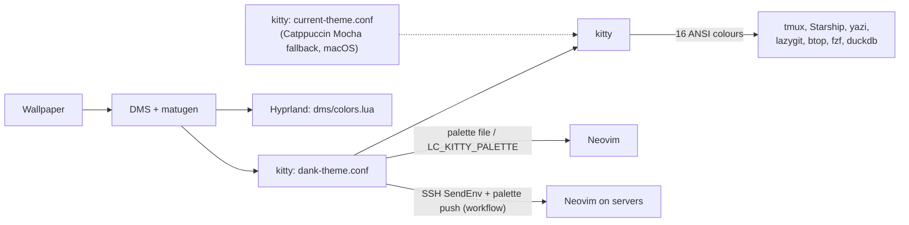

# dotfiles

[](https://github.com/anhtt20172948/dotfiles/actions/workflows/ci.yml)
[](LICENSE)

<!--
  HERO MEDIA PLACEHOLDER (deferred; scout report item R5).
  Goes here: a short recording of one wallpaper change re-theming kitty, tmux,
  local Neovim and Neovim over SSH, plus a still screenshot for the social
  preview. Keep it reproducible (scripted, from the palette fixtures) so it can
  be regenerated when the look changes.
-->

An Arch Linux + Hyprland workstation whose colours come from the wallpaper and
follow you everywhere. DMS derives a palette from the wallpaper, kitty applies
it, and tmux, Neovim, yazi, lazygit and the rest follow it, including Neovim on
remote servers over SSH. Neovim keeps every text colour at WCAG 4.5:1 contrast
against the real background. The same configuration runs on macOS (with a
Catppuccin Mocha fallback palette) and on Linux servers provisioned by the
[workflow](https://github.com/anhtt20172948/workflow) repository, and CI tests
it on Ubuntu and on stock macOS.

## Design principles

- **One palette source.** kitty's active palette is the only place colours are
  defined: DMS writes it from the wallpaper on Arch, and macOS uses the
  Catppuccin Mocha fallback. Every other tool uses ANSI colour names, so a new
  wallpaper re-themes everything without editing a config.
  `tests/palette_consistency_test.sh` rejects hex colours in active
  configuration.
- **Transparent surfaces.** Neovim (including sidebars, status lines and
  popups), tmux's status bar and btop draw no background of their own, so
  kitty's `background_opacity 0.8` and the wallpaper show through; borders
  carry the structure.
- **One accent, one shape.** Cyan (ANSI 6, which DMS fills with its primary
  colour) is the only marker of what is active: the kitty tab, the tmux session
  pill, current window and pane border, the fzf pointer, yazi's hovered row,
  Neovim's borders and the prompt's directory. Pills and tabs share lualine's
  slanted caps, and kitty's tab bar appears only with two or more tabs.
- **One prompt on every host.** [.config/starship.toml](.config/starship.toml)
  is the Starship prompt for bash and zsh, in ANSI names with the same accent
  and caps; `starship-plain.toml` is its ASCII twin for terminals without a
  Nerd Font (`STARSHIP_CONFIG=~/.config/starship-plain.toml`).
- **Readable by construction.** Neovim computes every text colour, file icons
  included, to at least 4.5:1 contrast against the actual background, and tests
  hold it there (`tests/nvim_visual.lua`, `tests/nvim_icons.lua`,
  `tests/nvim_lualine.lua`).
- **The palette travels.** The local shell exports the palette and SSH forwards
  it; a watcher pushes it to servers on every theme change. Remote Neovim reads
  it without a reconnect, and ANSI-only tools follow automatically because the
  local kitty renders them.
- **Links, not copies; no root.** `install.sh` symlinks only git-tracked files,
  moves conflicts to a backup instead of deleting them, and is safe to re-run.
  Tool installs and shell rc files belong to workflow, not to this repository.

## How the palette flows



kitty includes the Mocha fallback first and the DMS files after it, so DMS wins
whenever it has generated them ([kitty README](.config/kitty/README.md)).
Neovim needs the palette itself because it draws in truecolor: locally it reads
`LC_KITTY_PALETTE` (exported by the workflow shell rc) or the kitty palette
files; over SSH it reads the forwarded variable or the file workflow pushed.
The details are in [Palette over SSH](#palette-over-ssh).

## Quick start

On a workstation that already has the applications and workflow's tools (see
the table below):

```bash
git clone https://github.com/anhtt20172948/dotfiles.git ~/dotfiles
cd ~/dotfiles
./install.sh -n     # dry run: print what would be linked or backed up
./install.sh
```

### Bootstrap per platform

`install.sh` only links configuration. Applications come from the platform's
package manager, and CLI tools, shell rc files and palette transport come from
workflow.

| Platform | Install first | Then workflow | Then dotfiles |
| --- | --- | --- | --- |
| Arch Linux workstation (primary) | `pacman -S git zsh tmux kitty hyprland matugen python dux-shell` (`dux-shell` provides `dms-shell`, the `dms` desktop shell); the patched SFMono Nerd Font "Complete" family, installed by hand into `~/.local/share/fonts` (no package provides that family; see the [kitty README](.config/kitty/README.md)) | `make converge-local`: pinned CLI tools in `~/.local/bin` (Neovim, yazi, lazygit, fzf, bat, delta, atuin, btop, ...), bash/zsh rc, the `LC_KITTY_PALETTE` export, SSH `SendEnv`, and a systemd user unit that pushes the palette to servers on every DMS theme change. Starship and `starship init` for the tracked prompt are workflow's to add; until it does, hosts keep workflow's powerlevel10k prompt | `./install.sh` |
| macOS workstation | Homebrew, kitty, and the same hand-installed SFMono Nerd Font "Complete" family | `make converge-local`, as above; the palette watcher is a launchd agent on `current-theme.conf` | `./install.sh` (also installs Homebrew `coreutils` for tmux-which-key) |
| Linux servers (x86_64, aarch64) | `git`, `zsh` and `tmux` (workflow cannot install them without root) | `make converge LIMIT=<host>`: tools, shell rc, TPM plugins, then it clones this repository to `~/dotfiles` and links it with its own linker; the SSH server must accept `LC_*` (for example `AcceptEnv LC_*`) | nothing: workflow links it |

Workflow's inventory, prerequisites and commands are in its
[README](https://github.com/anhtt20172948/workflow#readme).

### DMS look inputs

The palette also depends on DMS settings that live only in
`~/.config/dms/settings.json`, which DMS rewrites and which is not tracked
here. These values produce the look this repository is tuned for; set them in
DMS's settings before judging contrast or comparing screenshots:

| Setting (`settings.json` key) | Value | Effect |
| --- | --- | --- |
| `currentThemeName` | `dynamic` | Colours come from the wallpaper. |
| `matugenScheme` | `scheme-tonal-spot` | Material You scheme that turns the wallpaper into the palette. |
| `matugenSpec` | `2025` | Material colour specification version used by matugen. |
| `radiusStrength` | `38` | Corner rounding of the shell (0-100, Material's baseline is 50), so a little squarer than stock. |
| `fontFamily`, `monoFontFamily` | `SF Pro Display` | Shell UI fonts (terminal and editor use SFMono Nerd Font from kitty). |
| `fontWeight` | `700` | Shell UI font weight. |
| `interfaceStyle`, `density` | `expressive`, `comfortable` | Shell layout style. |
| `popupTransparency`, `foregroundLayerTransparency` | `1`, `1` | Surface alpha of shell popups and layers: fully opaque. |
| `blurEnabled`, `blurBorderEnabled`, `blurBorderOpacity` | `true`, `true`, `0.35` | Background blur and its border. |

Compare a host with these values:

```bash
jq '{currentThemeName, matugenScheme, matugenSpec, radiusStrength, fontFamily,
  monoFontFamily, fontWeight, interfaceStyle, density, popupTransparency,
  foregroundLayerTransparency, blurEnabled, blurBorderEnabled,
  blurBorderOpacity}' ~/.config/dms/settings.json
```

### What `install.sh` does

The linker needs Bash, coreutils (including `readlink -f`) and Python 3.11+
for the agent settings merge. Keep `~/.local/bin` on `PATH` to use the helpers.

- Missing destinations are symlinked to this checkout. Existing real directories
  are traversed so machine-only files stay in place.
- Conflicting files or links are moved to `~/.dotfiles-backup/<timestamp>/`.
  Links already pointing here are left alone.
- Shared directories such as `~/.config`, `~/.local/bin` and agent state
  directories stay real; existing directory symlinks outside this checkout are
  preserved, so runtime data stays outside the checkout.
- Root documentation, tests and project-only settings are excluded from linking.
- A file deleted from the repository leaves its old link behind. From the
  checkout, `find ~ -maxdepth 4 -xtype l -lname "$PWD/*"` lists links into it
  that no longer resolve; remove them by hand.

Shell rc files (`.bashrc`, `.zshrc`, `.bash_profile`) are rendered by workflow,
and this repository carries no shell exports with one deliberate exception:
[.zshenv](.zshenv) exports the active `ai-acct` Claude token
(`CLAUDE_CODE_OAUTH_TOKEN`) and its fingerprint (`AI_ACCT_FINGERPRINT`) for
every zsh, including the non-interactive shells agent workers run in. It reads
the token from `~/.config/claude-accounts` and keeps the read out of xtrace; see
[Claude account switching](#claude-account-switching).

#### Agent settings

Global agent rules live in `.config/agents/AGENTS.md`; OpenCode links to them,
and `.config/agents/CLAUDE.md` is linked to `~/.claude/CLAUDE.md` to import them.
The installer preserves Claude credentials and leaves `~/.codex/AGENTS.md` alone.

The settings merge preserves unrelated fields in `~/.claude/settings.json` and
`~/.codex/config.toml`. Its values and footer items are defined in
[install-agent-statusline](.local/bin/install-agent-statusline). Claude's status
line uses [agent-statusline-claude](.local/bin/agent-statusline-claude) and needs
`jq`; Codex uses its native footer. Preview just the merge with:

```bash
~/.local/bin/install-agent-statusline --home "$HOME" --check
```

Firstmate's `config/crew-dispatch.json` is linked individually under
`~/.local/share/firstmate`, keeping its runtime directories real. Edits to that
linked file change this checkout.

#### Firstmate settings are per host

`captain.md` holds each host's own captain preferences, so it lives at
`~/.local/share/firstmate/data/captain.md` on every host and is intentionally
untracked (it is gitignored and `install.sh` never links or replaces it). Create
it from [docs/firstmate/captain.md.example](docs/firstmate/captain.md.example):

```bash
mkdir -p ~/.local/share/firstmate/data
cp docs/firstmate/captain.md.example ~/.local/share/firstmate/data/captain.md
```

A host where it is still a symlink into an old dotfiles checkout can turn it into
a real file (a no-op on a regular file or a missing path; a non-zero exit status
only means the path was not a symlink):

```bash
for f in data/captain.md; do p=~/.local/share/firstmate/$f; [ -L "$p" ] && cp --remove-destination "$(readlink -f "$p")" "$p"; done
```

## What's inside

| Path | Configuration | Docs |
| --- | --- | --- |
| `.config/nvim` | Neovim: Lua, lazy.nvim with `lazy-lock.json`, palette-derived transparent UI. | [Neovim](#neovim) |
| `.tmux.conf`, `.config/tmux` | Modular tmux: status bar, popups, persistent AI sessions, which-key menu. | [tmux README](.config/tmux/README.md) |
| `.config/extrakto` | Extra extrakto filters (git hashes) for picking text out of a pane. | [tmux README](.config/tmux/README.md) |
| `.config/kitty` | Terminal: font, palette include order, slanted tab bar, `kitten ssh` settings. | [kitty README](.config/kitty/README.md) |
| `.config/starship.toml`, `.config/starship-plain.toml` | Shell prompt for bash and zsh (Nerd Font and ASCII variants). | [Design principles](#design-principles) |
| `.config/hypr` | Hyprland 0.57 Lua config; loads the DMS-generated colours, layout and rules last. | [How the palette flows](#how-the-palette-flows) |
| `.config/yazi` | File manager: ANSI-only theme with Material folder icons, keymaps, and the duckdb, center-media and toggle-pane plugins. | |
| `.duckdbrc` | DuckDB CLI highlight colours (ANSI names), also used by yazi's duckdb previews. | |
| `.config/btop` | Resource monitor: built-in `TTY` theme, transparent background. | |
| `.config/lazygit` | Git TUI: ANSI-only theme. | |
| `.config/lazydocker` | Docker TUI: an empty placeholder, so lazydocker's defaults apply. | |
| `.config/atuin` | Shell history settings. | |
| `.config/clangd` | C/C++ language server: a trimmed clang-tidy check set. | |
| `.config/agents`, `.config/opencode` | Global agent rules for Claude Code, Codex and OpenCode. | [Agent settings](#agent-settings) |
| `.config/claude-mods` | Claude Code mods: crew-watch (Crew Monitor) and pixel-pet. | [Claude Code mods](#claude-code-mods) |
| `.config/treehouse`, `.no-mistakes`, `.gnhf`, `.local/share/firstmate/config` | Agent workflow tools: worktree pool, pre-push gate, unattended loops, Firstmate crew dispatch. | [Agent workflow](docs/agent-workflow.md) |
| `.local/bin` | Helpers: `ai-acct`, `show`/`download`, the agent status line, standalone installers. | [Claude account switching](#claude-account-switching), [Remote helpers](#remote-helper-scripts) |
| `.zshenv` | The active Claude account token for every zsh. | [What `install.sh` does](#what-installsh-does) |

## Guides

### Neovim

[init.lua](.config/nvim/init.lua) loads `core`, `configs.lazy` and
`current-theme`. Plugin declarations live in `.config/nvim/lua/plugins`, with
setup and helpers in `lua/core`, `lua/configs`, `lua/customize` and `lua/lib`.
The leader key is Space.

Floats use rounded borders and transparent surfaces. The fold/sign gutter uses
native Tree-sitter folds when a parser and fold query are available, otherwise
manual folds; files start unfolded and big files skip automatic folding.
Lualine stays under each split, with extra details at wider widths. Snacks owns
pickers, input and notifications; Noice owns command messages, Blink completion,
and native LSP owns hover/signature help. Session selection retains Telescope
on demand to preserve auto-session's delete/copy/alternate actions.

Set `NVIM_ASCII=1` before launching Neovim for ASCII diagnostic/git symbols,
file icons and dashboard actions, and mini.icons' ASCII folder style. This is a
manual client-font choice and is independent of SSH. File icons use the resolved
palette's text color; named folder icons keep their mini.icons identities.

| Binding | Action |
|---------|--------|
| `<leader>gw` | Pick a Git or treehouse worktree. |
| `<leader>ap` / `<leader>aP` | Push through no-mistakes / view pipelines. |
| `<leader>ag` / `<leader>aW` | Start a gnhf loop / an AI session in a worktree. |
| `<leader>aF` / `<leader>aR` | Open Firstmate / review a worker's changes. |
| `<leader>au` | Open the Claude account menu. |

#### Neovim colours

Neovim uses Kitty/DMS foreground and background for its neutral layers, keeping
Catppuccin's own syntax accents. Light backgrounds select Latte; dark backgrounds
select Mocha. All text colours (including comments and UI overlays) are adjusted
toward the foreground to meet WCAG 4.5:1 contrast against the editor background;
if the foreground is too dim, the adjustment uses black or white instead.
The DMS cursor colour (or URL colour when available) supplies borders, cursor and
active line accents. Neovim, sidebars, status lines and all popup surfaces use
transparent backgrounds, sharing Kitty's terminal opacity. Popup borders remain
visible, while cursor lines, visual selections and selected menu entries keep a
subtle surface fill. Contrast is measured against the unmodified Kitty/DMS
background behind the transparent window.

Comments alone are italic. Keywords, conditionals and loops are bold; functions,
types, variables, operators and rainbow delimiters are plain. Document heading
and emphasis styles retain their markup meaning. Constants and readonly LSP
variables use peach, parameters maroon, properties/members teal, builtin variables
red and builtin functions sapphire; ordinary variables use the foreground.
Uppercase names depend on the Python parser/LSP classifying them as constants or
readonly variables.

File icons retain nvim-web-devicons' per-filetype colours, adjusted to at least
4.5:1 contrast against the resolved terminal background, including the generic
file icon. Neo-tree, Snacks file pickers and Lualine use these colours;
mini.icons folder icons keep their existing appearance. `NVIM_ASCII=1` retains
the ASCII fallback. Theme reloads recompute from the original icon colours.
`tests/nvim_icons.lua` covers palette changes without plugins; with the installed
plugins, run `nvim --headless -u NONE -i NONE -l tests/helpers/check_devicon_colors.lua "$PWD"`
(and repeat with `NVIM_ASCII=1`) to check the providers and picker formatter.

### Other tools and the ANSI rule

Other terminal tools use ANSI colours, including btop's built-in `TTY` theme
and yazi's built-in theme (no flavour). Do not add hex colour literals to
active tool configuration. Neovim highlights must use the active Catppuccin
palette, preserving the existing highlight roles without retaining an
independent fixed palette. `tests/palette_consistency_test.sh` enforces this for
tracked files. Its commented exceptions cover kitty palettes, crew-watch named
palettes, pixel-pet sprite artwork, test fixtures/assertions, documentation,
and generated dependency locks. kitty's `kitten themes` downloads other terminal
themes on demand, so none are vendored here.

### Palette over SSH

Kitty's active palette is the colour source on both platforms. DMS writes
`~/.config/kitty/dank-theme.conf` on Arch Linux with Hyprland; macOS uses
`current-theme.conf` (Catppuccin Mocha) without DMS. In SSH sessions, Neovim first
resolves `LC_KITTY_PALETTE_SRC` from the tmux session environment before the
process environment, then reads the matching pushed file
`~/.config/kitty/remote-palette-<src>.conf`. The source
must contain only lowercase letters, digits and hyphens, with 1 to 32 characters.
The file must contain exactly one palette line in the format below. Missing or
malformed matching files and invalid or absent sources fall back to the most
recently modified valid `remote-palette-*.conf` file, using the last machine
that pushed. If no pushed file is valid, Neovim tries `LC_KITTY_PALETTE` from
the tmux session environment, then the process environment, then the existing
file fallbacks. Removed tmux variables (`-NAME`) and malformed values are ignored.
The tmux environment is read once with a 100 ms timeout during SSH startup only;
failures fall back without interrupting startup. Local sessions ignore pushed files
and the tmux environment.

`LC_KITTY_PALETTE` contains 18 or 19 colon-separated colours, ordered background,
foreground, then color0 through color15, with an optional cursor colour as entry 19.
The cursor supplies the primary UI accent on servers; 18-entry palettes retain
the Catppuccin lavender fallback. Each entry must be six lowercase hex digits
without `#`, whitespace, or newlines. Any other entry count or malformed value
is ignored. Pushed files use the same format with an optional final newline.

The workflow repo manages the local shell export and SSH `SendEnv` configuration;
servers must accept `LC_KITTY_PALETTE` and `LC_KITTY_PALETTE_SRC` (for example
through `AcceptEnv LC_*`).
The local export runs only outside SSH sessions, preserving a palette received
from the client. This carries the palette over plain `ssh`, lazyssh's direct
`/usr/bin/ssh`, and `kitten ssh`. These dotfiles do not alias `ssh` or copy palettes.
The server needs this Neovim configuration too.

If neither a pushed file nor an environment palette is valid, Neovim reads the
first available legacy file:
`remote-palette.conf` during SSH sessions only, then `dank-theme.conf`, then
`current-theme.conf`. It resolves symlinks. Existing remote snapshots remain a
compatibility fallback for hosts that already have them; they are no longer
updated and may be stale, but a valid forwarded variable takes priority over
these legacy files.
Missing or incomplete file palettes fall back to plain Mocha.

The workflow
repo manages a local watcher that pushes source-specific palettes to reachable
servers. After a local theme change, quit and reopen remote Neovim in the same pane
to read the latest pushed palette. Offline servers miss that push; the next SSH
connection still forwards the current palette, and the next theme change pushes
again. tmux refreshes both palette variables on attach. Neovim reads that session
environment even in existing panes. Panes without a source id use the newest valid
pushed file, so reopening Neovim picks up theme changes without a new pane,
re-attach, or reconnect.

Kitty shell integration, remote kitty installation, and connection sharing remain
disabled in `ssh.conf`, preserving the server's account login shell and existing
connection policy when explicitly using `kitten ssh`.

### tmux

[.tmux.conf](.tmux.conf) sources the modules in `.config/tmux`. The prefix is
`Ctrl-b`. `prefix a` opens the AI tool/session picker; `prefix A` attaches the
most recent live agent for the project. `prefix F` opens the agent workflow
menu, `prefix C` the crew view, `prefix E` the Claude account menu, and
`prefix Q` the quota TUI.

See the [tmux README](.config/tmux/README.md) for bindings and dependencies,
including `fzf`, `fd`, `rg`, `bat`, `jq`, `sqlite3` and `sesh`. Install tmux and
TPM through `workflow` on servers; the local tmux entrypoint also has a TPM
bootstrap for other installations.

On macOS, `install.sh` installs Homebrew coreutils for tmux-which-key's GNU
`realpath --relative-to`; tmux includes Homebrew's GNU tools in the plugin
environment. The workflow-only `install_agent_workflow` setup installs the same prerequisite.

### Agent workflow

The configuration integrates treehouse, no-mistakes, gnhf and Firstmate with
the AI CLIs. Firstmate's launcher offers agent, Claude account, model and
effort choices; an existing Firstmate window is focused directly. See
[docs/agent-workflow.md](docs/agent-workflow.md) for daily use.
Use `workflow` for supported server provisioning; `install.sh` links the
configuration and does not install these tools.

### Claude account switching

`ai-acct` selects named Claude OAuth tokens while keeping one shared
`~/.claude` directory and `~/.claude.json`, so history survives account switches.
Codex retains its single account. Requirements: `claude`, `jq`, Python 3 and
`quota-axi`; tmux is optional.

```bash
ai-acct add personal      # enter the token at the hidden prompt
ai-acct use personal
ai-acct list
ai-acct status            # quota for Claude accounts and Codex
```

Names start with a lowercase letter or digit and contain only lowercase
letters, digits, `-` and `_` (up to 32 characters). Tokens are read from stdin,
never arguments, and stored in `~/.config/claude-accounts/NAME.token` with mode
`600`; new account directories use mode `700`. Never commit tokens or put them
in shell commands or logs.

`ai-acct edit NAME` replaces a token, `ai-acct rename OLD NEW` renames an account,
and `ai-acct remove NAME` deletes it. `ai-acct use NAME` writes the `active`
selector, marks Claude onboarding complete and updates tmux's environment for
future panes. It validates the local token without an authentication request.
Running processes retain their token, and the parent shell is unchanged.
Launch with `ai-acct exec claude`, a new zsh shell, or exit the main Claude
process and run `ai-acct resume`. It asks the tmux launcher for the Firstmate
home (`FIRSTMATE_DIR`, else `FM_HOME`, else `~/.local/share/firstmate`), applies
its live-primary guard and resumes the newest session of that home by id with
the active account. `ai-acct exec --account NAME CMD...` binds a named account
to the child instead of following the selector, which is how the tmux launcher
starts Firstmate; once that pane exists the launcher also selects the account so
crews follow it.

`ai-acct list --quota` adds compact quota bars. Quota readings are cached;
older readings show their age and missing readings show an explicit unknown or
unavailable state. The account menu remains usable while quota refreshes.
In Neovim, `:AiAccount` shows quota and `:AiAccount use NAME` selects an account;
the status line shows `AI:NAME`.

### Claude Code mods

`.config/claude-mods` holds Claude Code mods (function-hooks plugins) and is a
local plugin marketplace, `dotfiles-mods`, listed in
`.config/claude-mods/.claude-plugin/marketplace.json`:

| Mod | What it draws | Docs |
| --- | --- | --- |
| crew-watch | The Crew Monitor: a Firstmate crew's agents, context, quota, activity and events, as a docked pane (`/crew`) and a status-line summary. | [crew-watch README](.config/claude-mods/crew-watch/README.md) |
| pixel-pet | A pixel-art cat above the prompt that reacts to turns, tools and errors (`/pet`). | [pixel-pet README](.config/claude-mods/pixel-pet/README.md) |

`install.sh` leaves the
folder in the checkout and calls `install-agent-statusline`, which declares its
real checkout path in `~/.claude/settings.json` (`extraKnownMarketplaces`)
and enables every mod the marketplace lists
(`enabledPlugins`), so every Claude Code session loads them however it was
started (a shell, Neovim, tmux, the desktop app). A mod turned off in `/plugin`
stays off when `install.sh` runs again. A mod that draws above the prompt stacks
its rows on what lies beneath (`next(e)`) instead of replacing it, so the mods'
bands show together.

Claude Code reads the mods from the folder itself, not from a copy: after
editing one, run `/reload-plugins` in a session. For live reload on every save
while working on a mod, start a session with `claude --plugin-dir
<checkout>/.config/claude-mods/<mod>` (replace `<checkout>` with the actual checkout
path). A new mod is a folder with a
`.claude-plugin/plugin.json` and its own `README.md`, listed in
`marketplace.json`, then `./install.sh`.

Check a change to a mod with `claude plugin validate`, `tsc -p` and
`claude plugin test` on its folder (`tests/claude_mod_test.sh` checks the
marketplace and the settings `install.sh` writes, runs each mod's
`tests/*_test.py` with `python3`, and runs the first and last for every mod
when `claude` is installed). `tsc -p` needs the types the engine
lays in `.claude-plugin/types` the first time it loads the mod.

### Remote helper scripts

`show` and `download` search SSH hosts in parallel for a path. `show` mounts
the remote root with `sshfs` and opens the item using a local application;
`download` copies it with `rsync`.

```bash
show /home/user/project/report.pdf
download /home/user/project/data.csv
download /home/user/project/dir ./local-dir
REMOTE_HOSTS="rack jupyter" download /path/to/file
SSH_CONFIG=~/.ssh/config.work show /path/to/file
```

Hosts come from non-wildcard aliases on `Host` lines in `~/.ssh/config`.
`Include` directives are not followed. Both helpers prompt when multiple hosts
match. `download` defaults to the remote basename in the current directory.
`SSH_CONFIG` selects the configuration for discovery and all connections,
including SSHFS and rsync. Quote its value when the config path contains spaces.
`download` requires Python 3 to resolve destinations that do not exist yet.

Both helpers support macOS's stock Bash 3.2. `show` uses macOS `open` for files
and directories; on Linux it keeps the file-type-specific application choices.

`show` schedules an unmount after ten minutes. The mount path is
`/tmp/mnt_show_<host>` with `@` and `.` replaced by `_`; to unmount early, use
`fusermount3 -u` on Linux or `umount` on macOS with that path. Failures are logged to
`${TMPDIR:-/tmp}/show-unmount.log`.

### Standalone installers

The supported way to provision servers is
[workflow](https://github.com/anhtt20172948/workflow), which owns tool installs
and shell setup. These standalone helpers remain in `.local/bin`:

- `install_zsh`: builds ncurses and zsh into `~/.local` and updates
  `~/.bash_profile` to launch zsh in interactive shells.
- `install_neovim`: builds a selected Neovim version into `~/.local` and adds
  environment settings to `~/.zshrc` when needed.
- `install_agent_workflow`: installs its pinned agent tools and AXI skills;
  `--update` reinstalls those pins.

These helpers are separate from `install.sh` and are not the supported server
provisioning path.

## Testing and CI

```bash
tests/run.sh lint   # ShellCheck on the scripts in tests/run.sh's LINT_FILES
tests/run.sh test   # tests/*.lua in headless Neovim, tests/*_test.sh, test_material_folder_icons.py
tests/run.sh        # both
```

Tests use stubs instead of downloaded plugins and need no network or display;
a case that needs a missing tool (Python 3.11+, `luac`) is skipped with a clear
message. `TEST_LOG_DIR` keeps each case's log. The same entry point is the
no-mistakes gate (`.no-mistakes.yaml`).

[CI](.github/workflows/ci.yml) runs on pull requests and pushes to `main`, with
pinned action SHAs and checksummed tool downloads:

- **lint**: ShellCheck 0.11.0 through `tests/run.sh lint`.
- **stylua**: StyLua 2.5.2 over the Neovim and Hyprland Lua.
- **test**: the full suite on Ubuntu 24.04 with Neovim 0.11.7 and Starship
  1.27.0, in a scratch `HOME`.
- **macos**: lint and tests on macOS 15 with stock `/bin/bash` 3.2 and BSD
  tools (plus Neovim and Starship), with GNU `timeout` kept off `PATH`.
- **secrets**: gitleaks over the full history.

## License

[MIT](LICENSE). Vendored components (the yazi plugins and the test fixtures)
retain their own license notices.
